# ShopNest-E-commerce-Business-Performance-Returns-Analysis
End-to-end e-commerce business analysis using Power Query, MySQL and Power BI. Cleaned 1,015 synthetic order records to 993, built a star schema, analysed returns, cancellations, revenue and customer behaviour, and developed SQL queries and interactive dashboards to present business insights.

Project Disclaimer: ShopNest is a fictional Indian e-commerce business. The dataset is entirely synthetic and was created for learning and portfolio purposes. All findings, figures and recommendations relate exclusively to this practice dataset and do not represent the performance of an actual business.

## Project Overview
ShopNest is a fictional Indian e-commerce business experiencing concerns around product returns, order cancellations, delivery performance and customer retention.
The management team needed a clearer understanding of its operational and commercial performance. However, the existing reporting process had data quality issues, including inconsistent dates, duplicate order IDs, missing values and inconsistent category and payment labels.
I approached this project from the perspective of a Business Analyst, taking the analysis from raw data preparation through to business recommendations.
The objective was to transform an unstructured order dataset into meaningful insights that could help management understand operational performance, identify potential issues and make informed decisions.

## Dataset at a Glance

| Metric | Details |
|---|---|
| Business | ShopNest (fictional Indian e-commerce store) |
| Raw records | 1,015 |
| Cleaned records | 993 |
| Customers | 378 |
| Analysis period | January–December 2024 |
| Data type | Synthetic practice dataset |

# Business Problems & Objectives
Three key stakeholders had different business questions.

| Stakeholder | Business Concern | Key Questions |
|---|---|---|
| VP of Operations | Returns, cancellations and delivery performance | How much order value is affected by returns and cancellations? Are returns increasing? How long do deliveries take? |
| Head of Customer Experience | Customer experience and product performance | Do payment methods or customer segments experience more returns? Which categories generate the most revenue? Why are customers returning products? |
| CFO | Data accuracy and financial reporting | Can management trust the reported order volumes and revenue? Are duplicate orders affecting financial figures? |

My objective: Define relevant KPIs, investigate the business questions, identify patterns and translate the findings into practical recommendations.

# Project Approach

I followed an end-to-end analytical workflow:
1. Data Cleaning: Used Power Query to standardise dates, correct inconsistent values, handle missing information and investigate duplicate records.

2. Data Modelling: Structured the cleaned dataset into a star schema consisting of one fact table and two dimension tables.

3. SQL Analysis: Loaded the structured tables into MySQL and developed queries to investigate business questions and calculate key performance indicators.

4. Dashboard Development: Built an interactive Power BI dashboard using DAX measures to present the findings.

5. Business Recommendations: Interpreted the results and identified areas where operational processes and data quality could be improved.

# Data Preparation & Cleaning
The original dataset contained approximately 1,000 order records with deliberately introduced data quality issues.
I used Power Query to prepare the data for analysis.

| Data Quality Issue | Cleaning Approach |
|---|---|
| Inconsistent date formats across approximately six formats | Created a custom column to identify date patterns and standardise dates. Used day-first interpretation for ambiguous dates unless the second number exceeded 12. |
| 45 records with missing or invalid dates | Converted unusable dates to null while retaining the records for non-date-based analysis. |
| Unit prices stored as text with ₹ symbols, INR and commas | Removed currency symbols and unnecessary characters, retaining numeric values and decimal points. |
| Inconsistent product category names | Standardised capitalisation, spacing and category labels. |
| Duplicate payment labels (COD and Cash On Delivery) | Consolidated both values into a single payment category. |
| Negative and zero quantities (33 records) | Replaced invalid quantities with null values. |
| Missing city, state and customer segment values | Replaced missing values with an Unknown category. |
| Missing delivery times and customer ratings | Retained these as null values to avoid introducing misleading information into averages. |
| Missing return reasons | Classified records as Not Applicable for non-returned orders and Reason Not Recorded for returned orders without a saved reason. |
| Duplicate records and conflicting order IDs | Removed 15 exact duplicate rows and retained one record for each of seven conflicting order IDs. |

**Final dataset: 993 records after cleaning, compared with 1,015 rows before duplicate removal. The cleaned dataset was retained for further analysis, with missing information handled according to the type of analysis being performed.**

# Data Model
I designed a simple star schema to separate transactional information from customer and product attributes.
| Table | Description | Key |
|---|---|---|
| FactOrders | Transaction-level information including order date, unit price, quantity, status, payment mode, delivery days, rating and return reason. | OrderID |
| DimCustomers | Customer-related attributes including city, state and customer segment. | CustomerID |
| DimProducts | Product attributes including category and product name. | ProductID |

# Relationships:
DimCustomers → FactOrders: One-to-many.
DimProducts → FactOrders: One-to-many.

Single-direction filtering from dimension tables to the fact table. The product dimension uses an index-generated ProductID because the original dataset did not contain a dedicated product identifier.

#Key Business Findings

**Returns & Cancellations**

Returns and refunds represented a significant proportion of the gross order value in the dataset. 39.5% of orders were returned or refunded. 12.5% of orders were cancelled.Returns and refunds represented approximately ₹1.27 crore in affected gross order value.
Cancelled orders represented approximately ₹41 lakh in affected gross order value.
Combined, these accounted for approximately 54% of the total gross order value of ₹3.1 crore before discounts.

**Business interpretation:**

Returns and cancellations represent a substantial proportion of the recorded order value. However, affected order value should not be interpreted as actual financial loss, as the dataset does not include the complete financial impact of refunds, recoveries, discounts, shipping costs or returned inventory.
Management should investigate the underlying causes rather than focusing solely on the overall return percentage.

# Return & Cancellation Trends
I compared the first and second halves of the year to understand whether returns and cancellations were worsening.

#Return & Cancellation Trends
| Metric | First Half | Second Half |
|---|---|---|
| Return Rate | 42% | 37% |
| Cancellation Rate | 11% | 15% |

# Key observations:

Return rates fluctuated between approximately 30% and 50%, without a consistent upward trend.
The return rate declined from 42% to 37% between the two halves. Cancellations increased from 11% to approximately 15% in the second half.

Business interpretation:
The data does not indicate a sustained increase in returns. However, the higher cancellation rate in the second half warrants continued monitoring rather than being treated as a confirmed trend.

# Returns Across Categories, Payment Methods & Customer Segments
I investigated whether returns and cancellations were concentrated in specific customer groups or payment methods.

Returns Across Categories, Payment Methods & Customer Segments
| Analysis Area | Observed Return Rate |
|---|---|
| Product Categories | 34%–48% |
| Payment Methods | 37%–42% |
| Customer Segments | 36%–44% |

# Additional observations:

1. Electronics recorded the highest return rate at approximately 48%.

2. Debit Card had the lowest cancellation rate at approximately 6%.

3. Individual groups generally contained only 100–120 orders.

# Business interpretation:

Returns were relatively widespread across the different categories, payment methods and customer segments. The observed differences are not sufficient to establish that any particular group is responsible for the problem.
The findings suggest that a broader operational investigation would be more appropriate than focusing on one payment method or customer segment.
These comparisons are descriptive, not statistical evidence of meaningful differences. The relatively small group sizes mean that the observed gaps could be influenced by random variation.

# Revenue by Product Category

I compared revenue contributions across product categories to understand which categories generated the highest order value. Revenue ranged from approximately ₹31 lakh for Sports to ₹45 lakh for Home & Kitchen.
**Home & Kitchen recorded the highest revenue contribution.
**The average order value was approximately ₹31,000.**
**Revenue differences largely followed the volume of orders across categories.**

# Business interpretation:
Categories with higher order volumes generally contributed more revenue. Revenue should therefore be considered alongside order volume and average order value when evaluating category performance.

# Delivery Performance

I examined average delivery times to identify potential differences across cities.

1.Overall average delivery time: approximately 4 days.

2.Indore recorded the lowest city average at 3.3 days.

3.Kochi recorded the highest city average at 4.7 days.

4.Delivery times ranged from approximately 1 to 7 days.

5.Approximately 28% of orders had no recorded delivery time.

# Business interpretation:
Kochi is a potential area for further investigation, but the available data does not establish a delivery performance problem. City-level averages were based on only 36–98 orders with recorded delivery times.
A consistent delivery tracking process and an agreed service-level target would be needed before drawing stronger conclusions.

# Reasons for Product Returns

I analysed the recorded return reasons to identify operational issues that could potentially be addressed.

Reasons for Product Returns
| Return Reason | Share of Returns |
|---|---|
| Quality Issue | 21% |
| Wrong Item | 18% |
| Changed Mind | 17% |
| Size Issue | 16% |
| Damaged Product | 14% |
| Reason Not Recorded | 15% |

# Key observations:

1.Quality issues were the largest individual return reason.

2.Wrong items and damaged products together accounted for approximately one-third of returns.

3.Approximately 15% of returned orders did not have a recorded reason.

# Business interpretation:

Wrong-item and damaged-product returns point towards potential improvements in order picking, packing and dispatch processes. Quality issues should also be investigated through longer-term product and supplier-level tracking.

# Customer Repeat Behaviour & Retention
I examined customer ordering patterns to understand repeat purchasing behaviour.

1.993 orders were associated with 378 customers.

2.Customers placed approximately 2.6 orders on average.

3.Approximately 75% of customers placed more than one order.

# Business interpretation:

The repeat customer rate provides a useful indication of purchasing behaviour. However, the no-repeat calculation is only a rough proxy for customer churn because the dataset contains just one year of transactions and does not include an actual customer churn date.
For that reason, I would avoid presenting this figure as a confirmed churn rate.

# Business Recommendations

Based on the analysis, I identified the following opportunities for improvement.

Business Recommendations
| Area | Recommendation | Expected Business Benefit |
|---|---|---|
| Returns Management | Address returns as a company-wide operational issue rather than focusing on one category or payment method. | A broader approach to reducing returns. |
| Order Fulfilment | Introduce order verification before dispatch and improve packaging checks. | Reduce wrong-item and damaged-product returns. |
| Product Quality | Monitor quality-related returns by product and supplier over a longer period. | Identify recurring quality issues and potential supplier problems. |
| Return Data Collection | Make return reasons mandatory when processing returns. | Improve visibility into return drivers and reporting accuracy. |
| Delivery Performance | Improve delivery tracking and establish a measurable target, such as 90% of orders delivered within five days. | Enable consistent delivery performance monitoring. |
| Cancellation Monitoring | Track cancellation rates monthly and investigate the increase observed in the second half. | Identify potential changes in customer or operational behaviour. |
| KPI Governance | Standardise definitions for returns, refunds, cancellations and revenue. | Ensure consistent reporting across departments. |
| Source Data Quality | Introduce validation checks for dates, order IDs, customer segments and other critical fields. | Reduce duplicate records and manual data cleaning. |

# SQL Analysis

I used MySQL to answer the business questions and validate the findings.
Some examples of the SQL analysis are included below.

### SQL Query Screenshots

The following screenshots show the SQL queries and their outputs used to analyse ShopNest's business performance.

#### 1. Overall Return Rate
This query analyses the overall percentage of returned orders.

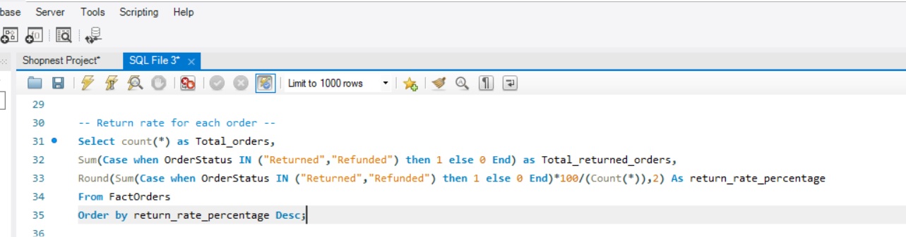

#### 2. Cancellation Rate
This query examines the percentage of orders cancelled.

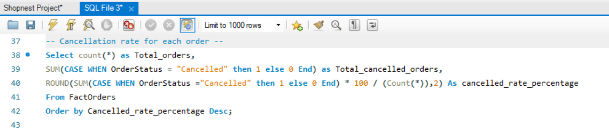

#### 3. Returns by Product Category
This query compares product returns across different categories.

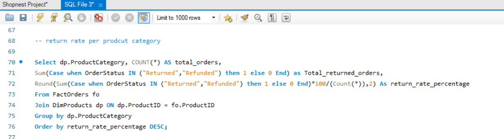

#### 4. Product Return Reasons
This query analyses the reasons recorded for product returns.

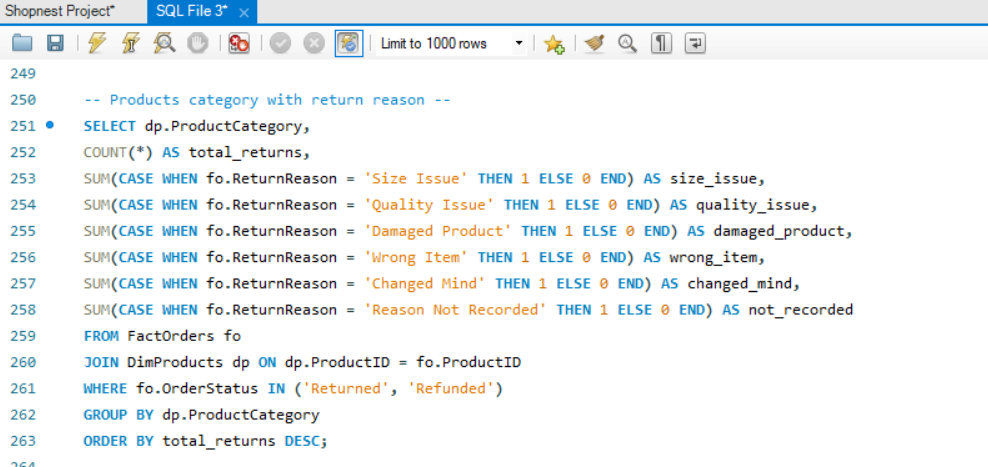

#### 5. Delivery Performance
This query examines delivery performance across different locations.

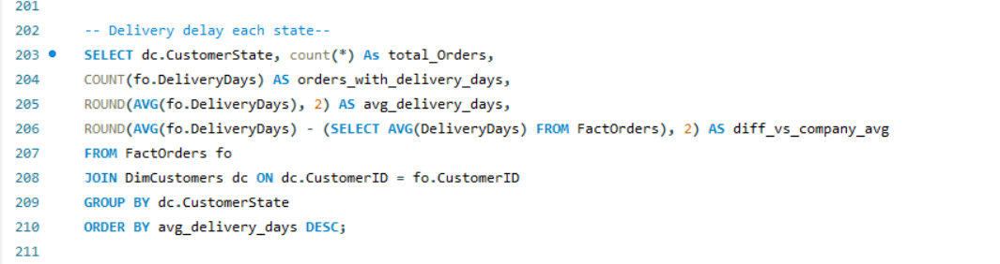

#### 5. Repeat Customer Analysis
This query identifies customers who placed more than one order during the analysis period.

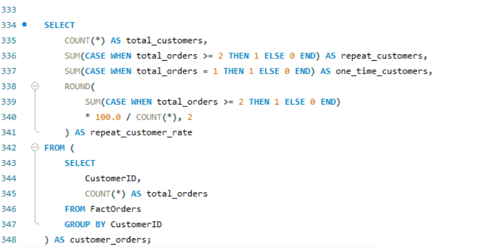

The same analytical approach was used to investigate cancellation trends, payment methods, customer segments, geographical performance and return reasons.
# Complete SQL Script
The complete SQL script for this project is available in the repository. It includes the SQL queries used to analyse ShopNest's business performance and answer the project's business questions.
## SQL Scripts

[View the full SQL script](ShopNest_SQL_Analysis_Queries.sql)

# Power BI Dashboard

I developed an interactive Power BI dashboard to present the findings in a structured and accessible format.

The dashboard consists of two main pages.

Page 1 – Order Overview

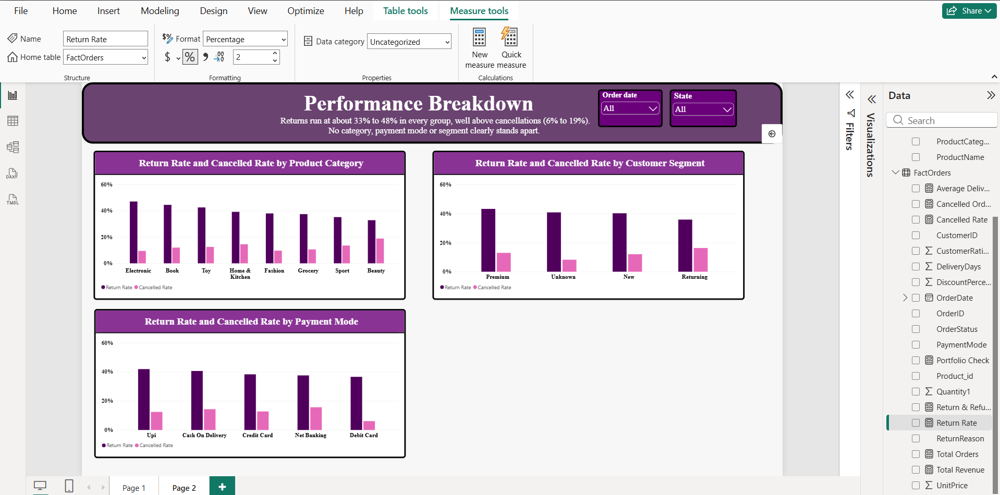

Provides a high-level view of order performance, revenue, returns and cancellations.

Page 2 – Performance Breakdown

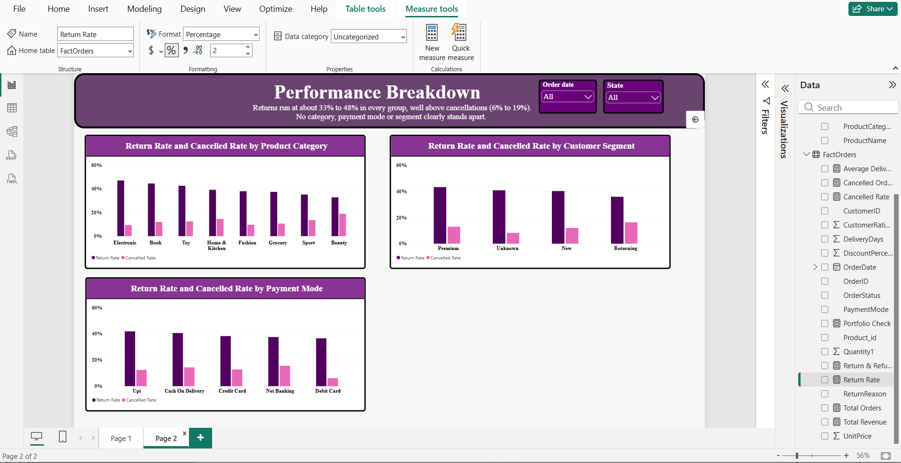

Explores performance across product categories, payment methods, customer segments, delivery performance and return reasons.

# Key DAX Measures

### Return Rate
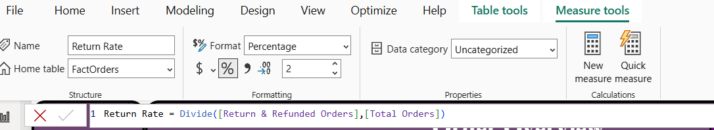

### Returned & Refunded Orders
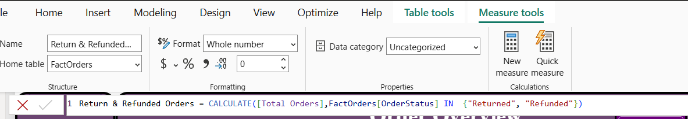

### Cancelled Rate
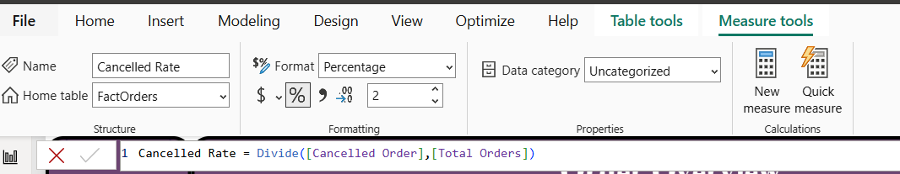

### Cancelled Orders
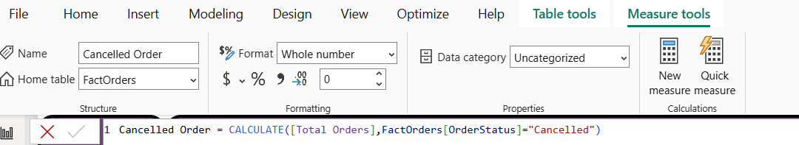

### Average Delivery Delay
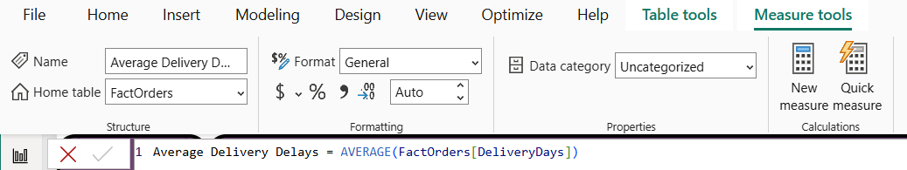

# Challenges & Lessons Learned

This project also helped me understand the importance of data validation and consistent analytical definitions.

1. Understanding order status correctly
Initially, I calculated the return rate using only the Returned status and missed 132 Refunded orders. This resulted in a return rate of approximately 26% instead of 40%.

I learned to examine all distinct values in a column before defining business logic.

2. Maintaining consistency between SQL and Power BI
I initially removed duplicate order IDs separately in Power BI and MySQL. Each environment retained a different record, resulting in small differences between the two sets of results.
For example:
SQL recorded 393 returns.
Power BI recorded 392 returns.

Revenue differed by approximately 0.1%.
I used the Power BI results for the dashboard and documented the discrepancy. Going forward, I would establish one cleaned source dataset and use it consistently across all analytical tools.

3. Avoiding misleading segmentation

Breaking down data into too many combinations, such as state, customer segment and payment method, created groups with very few records. Some groups showed extreme percentages based on only two orders.
I learned to display the underlying order count alongside percentage-based KPIs and avoid drawing conclusions from very small samples.

4. Handling inconsistent dates

Date standardisation was one of the most time-consuming parts of the project. Different date formats and invalid entries demonstrated how much data quality can affect the overall analysis.

# Project Limitations

1. The findings should be interpreted with the following limitations in mind:

2. The dataset is fictional and does not represent an actual e-commerce business.

3. The dataset contains 993 cleaned orders, which is sufficient for demonstrating the analytical workflow but limited for drawing conclusions about real-world business patterns.

4. Revenue is calculated using unit price multiplied by quantity, before discounts.

5. Approximately 30 orders have missing quantities and are excluded from revenue calculations.

6. Approximately 28% of orders have no recorded delivery time.

7. Most analytical groups contain approximately 100–120 orders, limiting the reliability of small differences.

8. Customer retention analysis is based on a single year of transactional data.

9. Delivery performance is measured using average delivery days because no agreed delivery target was provided.

10. Small differences between SQL and Power BI remain because duplicate records were handled separately in each environment.

If this were a real client engagement, I would clarify three business definitions before finalising the reporting:

1. Should refunded orders be included in the return KPI?

2. Should revenue be reported before or after discounts?

3. What delivery timeframe should define a late order?

# Tools & Technologies

| Tool | Application |
|---|---|
| Power Query | Data cleaning, transformation and standardisation |
| MySQL | Database management and SQL-based analysis |
| Power BI | Interactive dashboard development and visualisation |
| DAX | KPI calculations and analytical measures |

# Final Project Takeaway

This project gave me practical experience in approaching a business problem from start to finish: understanding stakeholder requirements, preparing inconsistent data, designing a relational data model, analysing business performance using SQL and presenting findings through Power BI.

More importantly, it helped me understand that business analysis is not just about calculating KPIs or creating dashboards. It is about questioning the data, understanding what the numbers actually mean, recognising limitations and communicating recommendations that support better business decisions.

Project Type: Business Analysis | E-commerce Analytics | Data Analytics

Tools: Power Query | MySQL | Power BI | DAX
